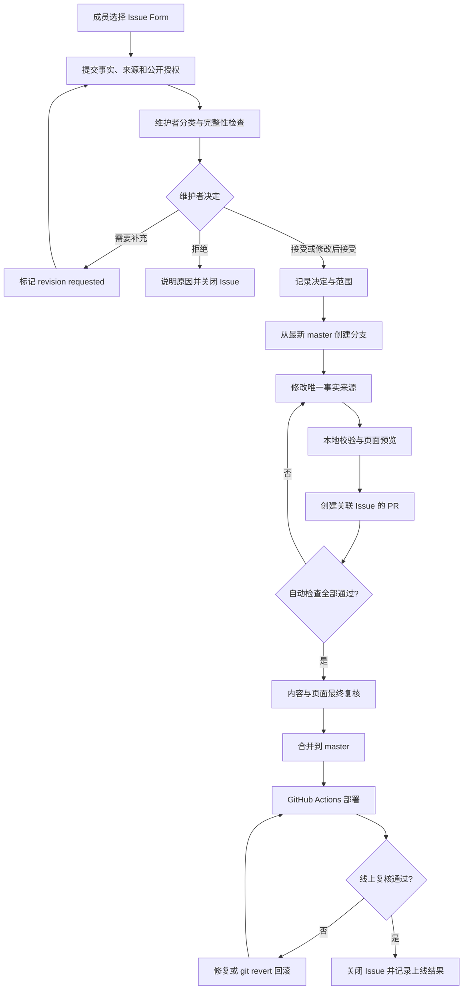

# LIMO 网站更新工作流设计与实施计划

版本：1.0  
更新日期：2026-10-24  
流程负责人：网站维护者  
适用范围：LIMO 网站的成员、论文、新闻、活动、招生信息、文字纠错与页面设计调整

## 1. 目标

实验室成员不直接修改或发布网站，而是通过统一入口提交更新请求。网站维护者负责核实事实、决定接受、退回补充、修改后接受或拒绝，并通过受保护的 Git 分支、Pull Request、自动检查和部署流程完成更新。

这套流程需要同时满足：

- 十余名成员都能方便地提交请求，不要求掌握 Git 或 Jekyll；
- 网站维护者保留最终编辑权和发布权；
- 每次修改都有请求来源、决策记录、代码变更和部署结果；
- 内容采用统一结构，避免同一信息在多个文件重复维护；
- 内容更新与 al-folio 主题升级尽量解耦；
- 错误更新能够快速回滚，不依赖强制推送或重写历史。

## 2. 核心决策

1. **GitHub Issue 是统一请求入口。** 成员默认只提交 Issue，不直接编辑 `master`，也不直接触发发布。
2. **网站维护者是最终决策者。** 请求内容不是自动发布指令；维护者可以接受、要求补充、修改后接受或拒绝。
3. **一个请求对应一个可追踪变更。** 被接受的请求必须关联一个分支和 Pull Request；PR 使用 `Closes #<issue-number>` 关联原 Issue。
4. **`master` 始终保持可部署。** 常规修改不得直接推送到 `master`，必须先通过自动检查。紧急修复也应留下 Issue 和提交记录。
5. **只维护一个事实来源。** 成员、论文、新闻、活动、研究方向和招生信息分别写入规定的数据文件，不在页面模板中复制同一数据。
6. **不自动接受成员提交的措辞。** 维护者可以统一英文、格式、标签、排序和页面布局，但不得擅自改变事实。
7. **内容请求与主题升级分开。** al-folio 升级使用独立维护分支，不和日常成员或论文更新混在同一个 PR 中。

## 3. 角色与权限

| 角色           | GitHub 权限                                       | 可以做什么                                                    | 不可以做什么                                 |
| -------------- | ------------------------------------------------- | ------------------------------------------------------------- | -------------------------------------------- |
| 实验室成员     | 无仓库写权限；可以创建和评论 Issue                | 提交公开信息、补充材料、确认修改结果                          | 合并 PR、直接推送 `master`、决定首页精选内容 |
| 请求涉及的本人 | 与普通成员相同                                    | 核实自己的姓名、照片、经历、链接和公开授权                    | 绕过维护者直接发布                           |
| 网站维护者     | Write 或 Maintain                                 | 分类请求、编辑内容、创建分支和 PR、接受或拒绝请求、发布和回滚 | 在没有记录的情况下修改敏感个人信息           |
| 备用审核者     | Triage 或 Write；建议由 PI 或指定教师担任         | 在维护者缺席时处理请求；复核高影响修改                        | 绕过既定检查或删除审计记录                   |
| GitHub Actions | 仅读取源码并执行检查；部署工作流具有 Pages 写权限 | 校验结构、构建、检查链接和无障碍、部署                        | 自动决定内容是否应当发布                     |

建议至少指定一名备用审核者，避免唯一维护者离开后流程停止。普通成员不需要成为仓库 Collaborator；公开仓库的 Issue 权限已经足够提交请求。

## 4. 端到端流程

## 5. 请求入口

成员从 GitHub 的 **New issue** 页面选择以下表单：

| 请求类型 | 现有表单                   | 典型内容                                     | 主要事实来源                                  |
| -------- | -------------------------- | -------------------------------------------- | --------------------------------------------- |
| 成员信息 | `1_profile_update.yml`     | 新成员、身份变化、毕业、照片、主页、研究方向 | `_people/`、`_data/cv/`、`assets/img/people/` |
| 论文     | `2_publication_update.yml` | 新论文、卷页、DOI、会议或期刊状态            | `_bibliography/papers.bib`                    |
| 新闻     | `3_news_update.yml`        | 获奖、毕业、访问、项目、重要论文动态         | `_news/`                                      |
| 网站纠错 | `4_correction.yml`         | 错字、失效链接、事实错误、显示异常           | 对应的唯一事实来源或样式文件                  |
| 学术活动 | `5_activity_update.yml`    | 活动、邀请报告、学术服务                     | `_data/activity/`                             |

提交者需要提供：

- 要修改的对象和当前页面；
- 明确的新事实，而不是“请更新一下”这类模糊描述；
- 可以公开核实的链接或上下文；
- 涉及个人信息或照片时的公开授权；
- 对姓名、身份、日期、作者顺序和链接的确认。

以下内容不得通过公开 Issue 提交：私人手机号、家庭地址、未公开录取信息、账号密码、内部评审材料或没有发布许可的图片。确有必要时先使用私下渠道完成核实，再由维护者仅把可公开部分记录到 Issue。

## 6. 分类、标签和状态

建议在 GitHub 中建立以下标签：

### 类型标签

- `type: profile`
- `type: publication`
- `type: news`
- `type: activity`
- `type: correction`
- `type: maintenance`

### 状态标签

- `status: needs review`：刚提交，等待维护者处理；
- `status: revision requested`：事实或材料不完整，等待提交者补充；
- `status: accepted`：内容已接受，等待实现；
- `status: in progress`：已有负责人或分支；
- `status: review`：PR 已创建，等待最终复核；
- `status: deployed`：线上页面已确认；
- `status: rejected`：不发布，并已说明原因。

### 可选优先级标签

- `priority: urgent`：隐私泄露、严重错误、主页不可用或错误招生信息；
- `priority: normal`：常规成员、论文和活动更新；
- `priority: backlog`：非必要设计优化或长期维护事项。

推荐状态流转：

`needs review → revision requested → needs review → accepted → in progress → review → deployed`

被拒绝的请求从 `needs review` 转为 `rejected` 后关闭。不要使用删除 Issue 的方式隐藏决策历史。

## 7. 维护者决策标准

维护者应在 Issue 中明确使用以下一种结论：

### Accepted

事实充分、公开授权明确、内容适合网站，按提交内容实施。

### Accepted with maintainer revisions

事实被接受，但维护者会调整语言、格式、分类、标签、照片裁切或页面呈现。评论中应简要说明调整范围。

### Revision requested

缺少必要事实、来源、授权或文件。应逐项列出需要补充的内容；收到回复后重新审核。

### Rejected

不适合公开、无法核实、与网站范围无关、与已有内容重复，或者请求者无权要求修改相关个人信息。关闭时给出简短、可理解的原因。

涉及以下内容时应提高核实级别：

- 成员身份、毕业学位、加入或离开时间：由本人、PI 或可靠公开来源确认；
- 招生政策、资助和职位：由 PI 或指定负责人确认；
- 获奖、媒体报道和项目：需要官方链接；
- 论文元数据：优先 DOI、期刊或会议官网、作者主页；
- 删除个人页面或照片：确认请求来自本人或实验室负责人。

不得为了消除校验警告而猜测毕业日期、学位、DOI、作者顺序或链接。

## 8. 建议处理时限

以下是初始服务目标，不是对成员的硬性承诺：

| 请求                       | 首次响应         | 接受后的目标处理时间     |
| -------------------------- | ---------------- | ------------------------ |
| 隐私、严重错误、网站不可用 | 1 个工作日内     | 尽快修复并复核           |
| 普通纠错、成员身份变化     | 3 个工作日内     | 5 个工作日内             |
| 论文、新闻、活动           | 3 个工作日内     | 可按每周批次集中发布     |
| 页面重设计、主题升级       | 5 个工作日内评估 | 单独排期，不承诺立即上线 |

长期无人补充的请求可以标记 `revision requested`，30 天后提醒一次，但不建议自动删除或自动拒绝。

## 9. 实施分支与提交规则

### 分支命名

- `content/issue-123-short-name`
- `fix/issue-123-short-name`
- `design/issue-123-short-name`
- `maintenance/al-folio-YYYY-MM`

每个分支原则上只处理一个 Issue；多个完全同类、低风险的小更新可以做成一个批次，但 PR 中必须逐一列出关联 Issue。

### 实施步骤

1. 更新本地 `master`，确认与 `origin/master` 一致；
2. 创建工作分支；
3. 按 [维护指南](update.md) 修改唯一事实来源；
4. 运行结构校验、格式检查和生产构建；
5. 启动本地服务器检查受影响页面及移动端布局；
6. 创建 PR，并填写 `Closes #<issue-number>`；
7. 在 PR 中记录维护者决定、修改范围、测试结果和必要截图；
8. 只有自动检查全部通过且最终内容确认后才合并。

提交信息应描述结果，例如：

- `Add profile for Firstname Lastname`
- `Update 2026 publication metadata`
- `Move Student Name to master's alumni`
- `Fix mobile publication controls`

避免使用 `update`、`fix stuff` 或成员姓名缩写等无法审计的提交信息。

## 10. Pull Request 审核清单

每个 PR 至少检查：

- 原 Issue 是否包含足够事实和公开授权；
- PR 是否准确关联 Issue；
- 是否只修改必要文件；
- 姓名、中文名、成员身份和拼音排序是否正确；
- 论文类型、作者顺序、年份、期刊或会议、DOI 是否正确；
- 新闻是否确有发布价值，且没有无意义地复制全部论文记录；
- 图片是否有使用许可、尺寸合理且替代文本准确；
- 是否引入第二份事实来源或硬编码重复内容；
- 桌面端、移动端、明暗主题是否正常；
- 自动检查是否全部通过；
- 是否影响 al-folio 覆盖文件或依赖版本；
- 页面上线后是否有明确的人工复核对象。

对于维护者自己实现的修改，推荐由备用审核者检查高影响内容。若目前只有一位维护者，至少使用 PR、自审 diff 和全部自动检查，不应为了方便长期直接提交 `master`。

## 11. 自动质量门禁

当前仓库已经具备以下检查：

| 检查     | 工作流或命令                                                   | 阻止的问题                                   |
| -------- | -------------------------------------------------------------- | -------------------------------------------- |
| 内容结构 | `ruby scripts/validate_content.rb`                             | 缺字段、无效分类、重复键、错误关联、无效日期 |
| 格式     | `npx prettier . --check`                                       | YAML、Markdown、Liquid、CSS 和配置格式不一致 |
| 生产构建 | `bundle exec jekyll build`                                     | Liquid、配置、依赖或资源生成失败             |
| 主题兼容 | `bundle exec al-folio upgrade audit`                           | 与当前 al-folio API 不兼容                   |
| 覆盖审计 | `bundle exec al-folio upgrade overrides audit --fail-on-stale` | 未登记或过期的主题覆盖                       |
| 内部链接 | `broken-links.yml`                                             | 构建后失效的内部 URL、资源和锚点             |
| 无障碍   | `axe.yml`                                                      | 主要页面的可访问性问题                       |
| 部署     | `deploy.yml`                                                   | 仅在通过构建后更新发布分支                   |

建议把以下状态检查设为 `master` Ruleset 的必需检查：

- `Validate website content / validate`
- `Prettier code formatter / check`
- `Deploy site / deploy`
- `Check rendered site links / link-checker`
- `Axe accessibility testing / check`

`Deploy site / deploy` 在 PR 中只执行验证构建，不应发布公开网站；合并到 `master` 后才执行部署步骤。

## 12. GitHub 仓库设置

需要由仓库管理员在 GitHub 网页中完成以下一次性设置，这些设置不能仅靠仓库文件自动启用。

### `master` Ruleset

- Require a pull request before merging；
- Require status checks to pass；
- Require conversation resolution；
- Require Code Owner review；
- Dismiss stale approvals when new commits are pushed；
- Block force pushes；
- Block branch deletion；
- 限制能够绕过规则的人数。

如果只有一位维护者，先确定备用审核者再启用“一次批准”。否则可以暂时要求 PR 和全部检查、允许维护者受控绕过，避免仓库被永久锁住；增加第二位审核者后再收紧。

### Actions 与 Pages

- Actions 使用最小权限；
- 常规检查只需要 `contents: read`；
- 只有部署 Job 获得发布所需写权限；
- GitHub Pages 的发布来源保持与现有部署工作流一致；
- 不允许来自未审核 Issue 的内容自动生成提交或自动部署。

## 13. 发布与线上验收

合并后执行：

1. 等待 `Deploy site` 成功；
2. 打开线上受影响页面，而不是只看本地页面；
3. 检查导航、正文、图片、链接、移动端和明暗主题；
4. 对论文筛选、成员排序或交互按钮等功能执行一次实际操作；
5. 在原 Issue 中记录部署提交和线上页面地址；
6. 标记 `status: deployed`，确认无误后关闭 Issue。

一次请求只有在“线上页面验证完成”后才算 Done，不能把“代码已合并”等同于“网站已更新”。

## 14. 失败与回滚

### 部署失败但线上旧站正常

- 不要反复手工重跑而不查看日志；
- 在原 PR 或新修复 PR 中修正失败原因；
- 保持旧站不变，直到新构建通过。

### 已上线内容存在严重错误

- 新建或关联一个 `priority: urgent` Correction Issue；
- 对单一错误创建最小修复提交；
- 如果短时间无法修复，使用 `git revert <merge-commit>` 创建可审计回滚；
- 不使用 `git reset --hard` 或强制推送改写公共历史；
- 回滚后重新检查部署和页面缓存。

### 个人隐私或未授权图片

先从页面移除公开内容，再补完整审计记录。Git 历史仍可能保存旧数据；若涉及真正敏感信息，需要按照 GitHub 的敏感数据清除流程另行处理，而不能只删除当前文件。

## 15. 内容的唯一事实来源

| 内容             | 唯一维护位置                         |
| ---------------- | ------------------------------------ |
| 成员目录与简介   | `_people/<member-id>.md`             |
| 成员 CV          | `_data/cv/<member-id>.yml`           |
| PI 独立页面      | `_pages/pi.md`                       |
| 头像             | `assets/img/people/`                 |
| 论文             | `_bibliography/papers.bib`           |
| 新闻             | `_news/`                             |
| 活动、报告和服务 | `_data/activity/`                    |
| 研究方向         | `_data/research_areas.yml`           |
| 论文主题词表     | `_data/publication_topics.yml`       |
| 招生信息         | `_data/recruitment.yml`              |
| 页面布局与组件   | `_layouts/limo-*`、`_includes/limo/` |
| LIMO 样式        | `_sass/limo/`                        |

具体字段、允许值和本地命令以 [update.md](update.md) 为准。本计划规定治理和流转，`update.md` 规定具体如何编辑数据。

## 16. al-folio 更新策略

主题升级不应夹带日常内容更新。建议每季度检查一次，只有安全修复、浏览器兼容问题或确有价值的新功能时才升级。

升级步骤：

1. 创建 `maintenance/al-folio-YYYY-MM` 分支；
2. 更新 Gem 与 lockfile；
3. 运行主题兼容和覆盖审计；
4. 阅读每个上游冲突，不批量接受未知覆盖；
5. 构建并检查 Home、Research、PI、People、Publications、News、Join Us；
6. 检查至少一个成员 CV、活动页、移动导航和明暗主题；
7. 单独建立 PR，记录升级前后版本及视觉变化；
8. 合并后完成线上回归测试。

LIMO 自有代码应继续放在 `_layouts/limo-*`、`_includes/limo/` 和 `_sass/limo/`，避免重新覆盖上游同名文件。

## 17. 自动化边界

### 应该自动化

- Issue 表单收集必填信息；
- 内容结构、格式、构建、链接和无障碍检查；
- 合并后的部署；
- 定期外部链接检查；
- 失败通知和待补充请求提醒。

### 不应该自动化

- 根据 Issue 内容直接修改 `master`；
- 自动接受个人信息、学位、获奖或招生信息；
- 自动决定 `selected` 或 `homepage_featured`；
- 自动关闭仍在等待事实核实的请求；
- 自动接受所有 al-folio 上游覆盖变化。

未来如果引入机器人生成草稿 PR，也必须保持“只生成草稿、不能自行合并”的边界。

## 18. 当前实施状态

| 项目                       | 状态               | 说明                             |
| -------------------------- | ------------------ | -------------------------------- |
| 五类 Issue Forms           | 已完成             | 成员、论文、新闻、纠错、活动     |
| 禁止空白 Issue             | 已完成             | 请求必须使用结构化入口           |
| CODEOWNERS                 | 已完成             | 当前所有文件由网站维护者负责     |
| PR 模板                    | 已完成，需小幅完善 | 后续增加 Activity 变更类型复选框 |
| 内容结构校验               | 已完成             | `scripts/validate_content.rb`    |
| 构建、格式、链接、Axe 检查 | 已完成             | GitHub Actions 已配置            |
| al-folio 隔离与覆盖审计    | 已完成             | LIMO 组件已命名空间化            |
| 自动部署                   | 已完成             | `master` 更新后触发              |
| CSS 缓存版本               | 已完成             | 本地 Sass 变化会生成新版本号     |
| GitHub 标签                | 待网页端配置       | 按第 6 节建立                    |
| `master` Ruleset           | 待网页端配置       | 按第 12 节建立                   |
| 备用审核者                 | 待组织决定         | 建议至少一人                     |
| PR 预览 URL                | 可选后续           | 当前由本地预览和 PR 构建验证替代 |
| 请求时限和批量发布时间     | 待试运行确认       | 可先采用第 8 节建议值            |

## 19. 推行计划

### 阶段 A：一次性配置

1. 确定网站维护者和备用审核者；
2. 创建类型、状态和优先级标签；
3. 配置 `master` Ruleset 和必需状态检查；
4. 检查 Actions 与 Pages 权限；
5. 在实验室群中发布请求入口和简短说明。

### 阶段 B：试运行

1. 选择一条真实但低风险的成员或论文更新；
2. 由普通成员完整填写 Issue Form；
3. 维护者按本计划记录决定、创建 PR、合并和上线；
4. 记录流程耗时、缺失字段和重复沟通点；
5. 调整表单字段、标签和处理时限。

### 阶段 C：正式运行

1. 所有新请求统一进入 Issue；
2. 每周固定一到两次处理普通请求；
3. 紧急纠错随时处理；
4. 每月检查未关闭请求和失败工作流；
5. 每季度检查外部链接、成员状态、依赖与 al-folio 更新需求。

## 20. 完成标准

一项网站更新只有同时满足以下条件才算完成：

- 原始请求和公开授权可追踪；
- 维护者的接受或修改决定有记录；
- 修改写入正确的唯一事实来源；
- PR 与 Issue 相互关联；
- 自动检查全部通过；
- 合并提交存在于 `master`；
- 部署工作流成功；
- 线上目标页面经过人工确认；
- Issue 标记为 deployed 并关闭；
- 若产生新维护规则，`update.md` 或本计划已经同步更新。

## 21. 首轮待办清单

- [ ] 指定一名备用审核者；
- [ ] 在 GitHub 创建第 6 节标签；
- [ ] 配置 `master` Ruleset；
- [ ] 选择并固定必需状态检查；
- [ ] 在 PR 模板中增加 Activity 类型；
- [ ] 决定普通请求的固定处理日；
- [ ] 用一条真实请求完成端到端试运行；
- [ ] 向全组发布 Issue 提交入口；
- [ ] 试运行一个月后复盘并更新本文件。
